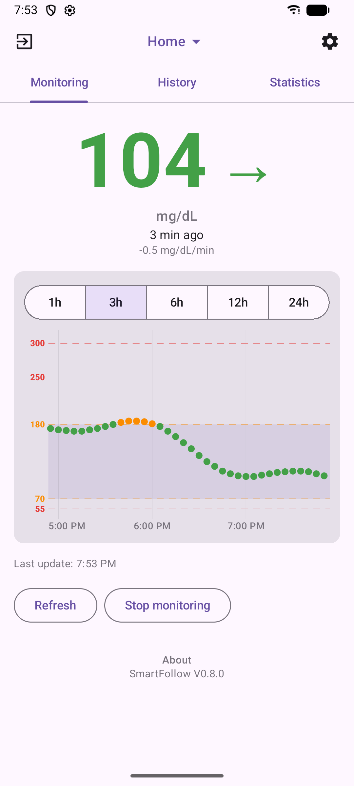
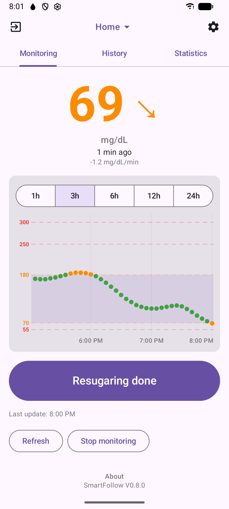
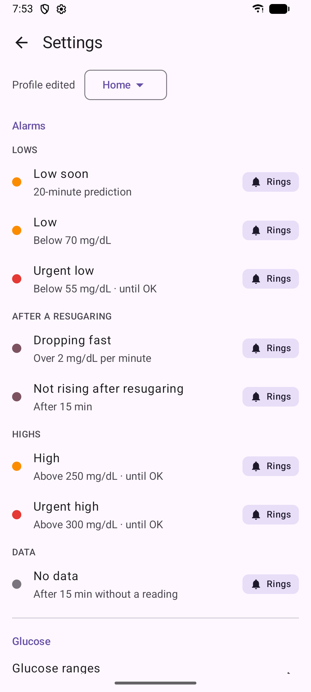
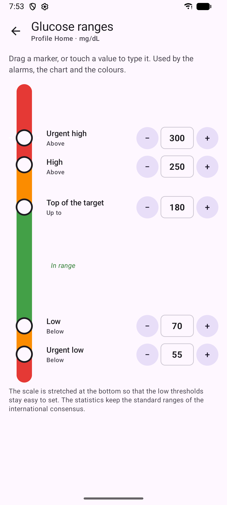
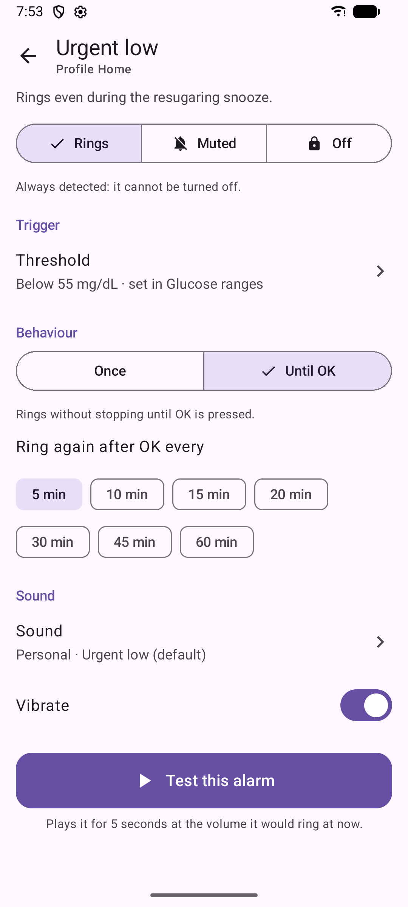
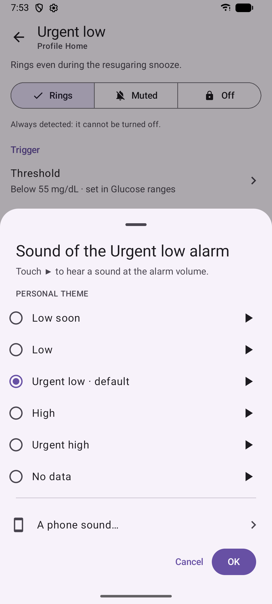

# SmartFollow

**Calm and reliable glucose alarms for parents following a Dexcom G7 wearer, with a one-tap
resugaring snooze.**

[](https://github.com/Sebastienlejeune/SmartFollow/actions/workflows/ci.yml)
[](LICENSE)

<p align="center">
  
  
  
  
</p>

> **Not a medical device.** Keep the official Dexcom Follow app installed as a backup. See the
> [disclaimer](#disclaimer).

## Why

At night, after a low, you give sugar to your child. Then the follow app keeps ringing every few
minutes until the glucose climbs back, and the whole family is awake. SmartFollow fixes that:

- **Resugaring snooze**: one tap silences the low alarms while the carbs work (25 minutes by
  default).
- **Safety first**: the urgent low, a fast drop and "not rising after resugaring" still ring
  during the snooze.
- **Two parents, one state**: a resugaring or an OK on one phone silences the other. The
  iPhone gets the alarms through [ntfy](https://ntfy.sh) and a web page, with no App Store app.

## Features

- **Alarms**: urgent low, low, low soon (trend prediction), fast drop, no recovery, no data, high,
  urgent high. Each one rings, is muted or is off, once or until OK, with its own sound.
- **Profiles**: Home, School, Discreet (only the lows ring), switched from the top bar or a
  quick settings tile.
- **Night**: alarms ring lower at night, and a summary of the night arrives in the morning.
- **Follow-up**: chart, history (one line per episode), statistics (time in range, GMI,
  variability) and CSV export.
- **Private**: no analytics; the data stays on your phone and, if you want one, on your own
  server.

| Monitoring | A low | Settings | An alarm | Sounds |
|:---:|:---:|:---:|:---:|:---:|
|  |  |  |  |  |

## How it works

```
Dexcom G7 ──► Dexcom Share ──► SmartFollow app (Android, works on its own)
                    │                    ▲
                    └──► SmartFollow server (optional) ──ntfy──► iPhone (ntfy + web page)
```

The Android app reads the glucose from Dexcom Share, the service behind Dexcom Follow, and
raises the alarms itself. The optional server does the same for the iPhone and shares the
parents' actions between the phones.

## Getting started

1. **Build the app**: SmartFollow is distributed as source code only. With JDK 17+ and the
   Android SDK, run `./gradlew :app:assembleDebug`, then install
   `app/build/outputs/apk/debug/app-debug.apk` from Android Studio or with `adb install`.
2. **Try it**: debug builds accept the `demo` account (any password), which shows synthetic
   readings.
3. **Sign in** with the Dexcom account of the **sensor wearer**, not a Follow account. Sharing
   must be enabled in the Dexcom G7 app, with at least one follower.
4. **Optional**: deploy the server for the second parent's iPhone, see
   [deploy/DEPLOY.md](deploy/DEPLOY.md).

Requires Android 10 or later.

## Documentation

- [Technical documentation](docs/TECHNICAL.md): modules, alarm rules, app and server.
- [Server deployment](deploy/DEPLOY.md), [changelog](CHANGELOG.md).
- [Contributing](CONTRIBUTING.md), [code of conduct](CODE_OF_CONDUCT.md),
  [security policy](SECURITY.md).

## Privacy

The Dexcom credentials, readings, settings and history stay on the phone. The app only talks
to the Dexcom Share servers of the selected region and, if one is set, to your own SmartFollow
server; it has no analytics. The password and the server token are encrypted with an Android
Keystore key, and Android backup is disabled. See [deploy/DEPLOY.md](deploy/DEPLOY.md) for the
server's privacy notes.

## Disclaimer

- **This software is not a medical device.** It is not cleared or approved by any health
  authority and must not be used to make treatment decisions. Alarms can be late or missing
  (network, Dexcom Share outage, phone settings, bugs). Always keep the official Dexcom
  apps and their alerts as the reference.
- This project is not affiliated with, endorsed by or supported by Dexcom, Inc. or Insulet
  Corporation. Dexcom, Dexcom G7, Dexcom Share and Dexcom Follow are trademarks of
  Dexcom, Inc.; Omnipod is a trademark of Insulet Corporation. They are used only to
  describe compatibility.
- It relies on the unofficial, undocumented Dexcom Share API, which can change or stop
  working at any time. Using it may be subject to Dexcom's terms of use; only use it with
  an account you are entitled to use.
- The software is provided "as is", without warranty of any kind; see [LICENSE](LICENSE).

## License

[MIT](LICENSE). The Dexcom Share protocol implementation is based on the behaviour
documented by [pydexcom](https://github.com/gagebenne/pydexcom) (MIT); no code was copied
from it. Third-party material is listed in [NOTICE](NOTICE).
